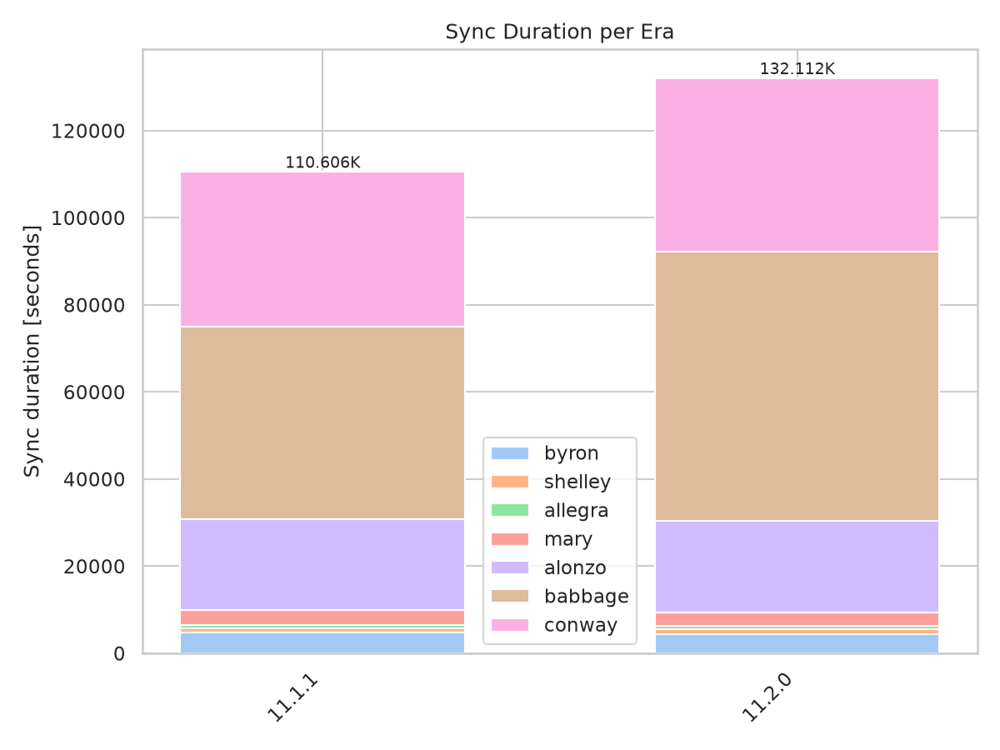
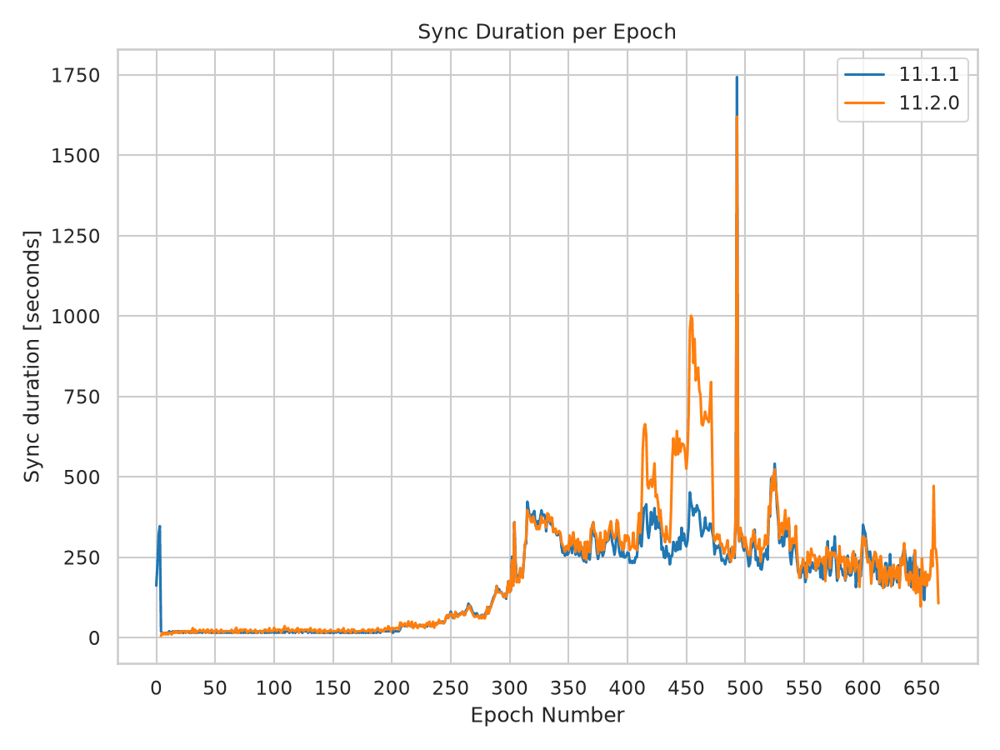
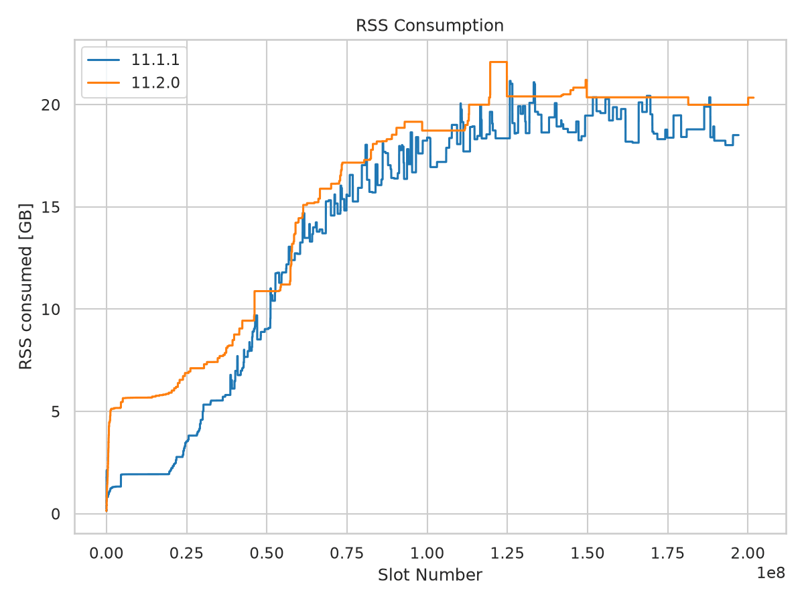
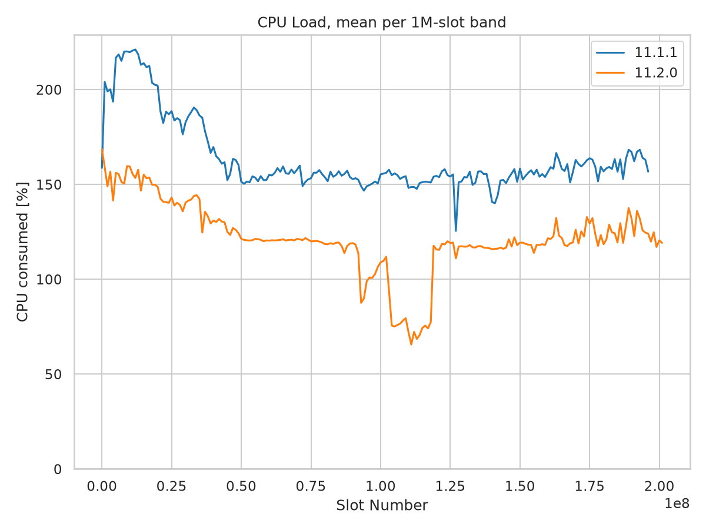

Mainnet Sync Report - 11.2.0
============================

Mainnet sync from genesis, comparing ``cardano-node`` 11.2.0 against 11.1.1.
The :doc:`previous report <mainnet_11_1_1>` found that 11.1.1 resolved the large
11.1.0 memory excursions but still consumed more memory than the 11.0.1 baseline.
This report checks whether that residual gap remains and examines configuration
changes that limit attribution of the new results to node code alone.

Two 11.1.1 runs were conducted to assess the effect of snapshot settings on
memory consumption. This report uses the short-delay run, with a 4,320-slot
snapshot interval and a 300-600 s write-delay range. Measurements from the
other 11.1.1 run are not included.

**Summary**

* **Memory remains elevated.** Peak RSS rises from 21.16 to 22.08 GiB (+4.4%),
  and peak garbage-collector live data rises from 15.94 to 18.03 GiB (+13.1%).
  Peak RSS is now 43.1% above the historical 11.0.1 baseline.
* **No return of the severe sawtooth.** No memory sample exceeds 25 GiB.
  Node 11.2.0 instead holds long heap plateaus, with fewer decreases than 11.1.1.
* **Sync is slower with lower CPU utilization.** Elapsed sync time increases
  19.4%, while mean CPU load falls from 157% to 112% of one core. Babbage accounts
  for most of the additional time.
* **Configuration is not controlled.** The runs switch from Praos to Genesis
  mode and from short snapshot delays to delays of up to six hours. These are
  plausible contributors, not demonstrated causes of the memory or speed changes.

Key Metrics
-----------

.. list-table:: Whole-run measurements
   :widths: 40 20 20 20
   :header-rows: 1

   * - Metric
     - 11.1.1
     - 11.2.0
     - Change
   * - Sync time
     - 110,606 s
     - 132,111 s
     - +19.4%
   * - Peak RSS
     - 21.16 GiB
     - 22.08 GiB
     - +4.4%
   * - Mean RSS
     - 15.67 GiB
     - 17.56 GiB
     - +12.0%
   * - Peak GC live bytes
     - 15.94 GiB
     - 18.03 GiB
     - +13.1%
   * - Mean CPU load
     - 157%
     - 112%
     - -28.8%
   * - Total CPU time
     - 173,469 s
     - 148,307 s
     - -14.5%
   * - Last slot at sync completion
     - 197,064,367
     - 201,746,270
     - +4.7 million

CPU load is expressed as percent of a single core: 112% is approximately 1.12
cores busy on average. Memory values use GiB (2**30 bytes).

Sync Performance
----------------

Node 11.2.0 takes 5 h 58 min longer to sync. Its chain endpoint is 4.7 million
slots later (+2.4%), but chain growth does not explain the largest slowdown:
Babbage covers the same fixed slot range in both runs and takes 17,420 s longer
(+39.4%). This accounts for 81.0% of the whole-run increase of 21,505 s.

.. list-table:: Sync duration per era, seconds
   :widths: 25 25 25 25
   :header-rows: 1

   * - Era
     - 11.1.1
     - 11.2.0
     - Change
   * - Byron
     - 4,701
     - 4,402
     - -6.4%
   * - Shelley
     - 1,057
     - 1,110
     - +5.0%
   * - Allegra
     - 805
     - 794
     - -1.4%
   * - Mary
     - 3,292
     - 3,159
     - -4.0%
   * - Alonzo
     - 20,901
     - 21,018
     - +0.6%
   * - Babbage
     - 44,224
     - 61,644
     - +39.4%
   * - Conway
     - 35,626
     - 39,985
     - +12.2%
   * - **Total**
     - **110,606**
     - **132,111**
     - **+19.4%**

The total uses the recorded whole-sync duration. The individual 11.2.0 era
durations sum to 132,112 s, one second more than that total.

Conway is not an equal-work comparison: its recorded length grows from 63.504
to 68.256 million slots. Recorded throughput falls from 1,782 to 1,707 slots/s
(-4.2%). Byron also has a measurement artifact: both nodes start syncing at
genesis, but era timing begins only after the startup readiness check. By that
first timed observation, 11.2.0 has reached approximately slot 102,085 in epoch
4, while 11.1.1 is still near slot 9,540 in epoch 0. The result generator uses
the first observed epoch to calculate the era's slot count, yielding 4,406,400
rather than 4,492,800 slots. The difference is four Byron epochs of 21,600 slots
each, not skipped chain history. Because timing omits the initial syncing and
the slot count rounds to whole epochs, the shorter recorded Byron duration
should not be read as a clean performance improvement.

   Sync duration per era. Babbage accounts for most of the additional time.

   Per-epoch durations show pronounced additional delays within Babbage in
   11.2.0, especially around epochs 400-470.

Memory Consumption
------------------

The residual memory gap identified in 11.1.1 remains visible. Against 11.0.1's
15.43 GiB peak RSS and 10.28 GiB peak live data, 11.2.0 reaches 22.08 GiB and
18.03 GiB, respectively. These are historical comparisons, not controlled
same-configuration measurements.

The shape changes again. Node 11.1.1 repeatedly reduces its heap after reaching
the late-chain plateau. Node 11.2.0 has only four heap decreases across the
recorded resource samples, holding memory near 20-22 GiB for long stretches.
It does not reproduce 11.1.0's 36.15 GiB RSS peak or its large oscillations.

.. list-table:: Heap shape and retained data
   :widths: 50 25 25
   :header-rows: 1

   * - Measure
     - 11.1.1
     - 11.2.0
   * - Nonzero heap samples with a recorded tip
     - 108,428
     - 130,567
   * - Peak RTS heap
     - 21.07 GiB
     - 21.98 GiB
   * - Mean RTS heap
     - 15.59 GiB
     - 17.45 GiB
   * - p99 RTS heap
     - 20.34 GiB
     - 21.98 GiB
   * - Heap decreases
     - 90
     - 4
   * - Heap samples > 20 GiB
     - 3.5%
     - 31.9%
   * - Heap samples > 25 GiB
     - 0.0%
     - 0.0%
   * - Peak GC live bytes
     - 15.94 GiB
     - 18.03 GiB
   * - Mean GC live bytes
     - 6.86 GiB
     - 8.34 GiB
   * - Major GCs during the resource-log window
     - 1,940
     - 812
   * - Allocation during the resource-log window
     - 286 TB
     - 257 TB

The live-data increase means the change is not solely unused RTS heap capacity.
It does not establish a leak or identify which subsystem retains the data. The
major-GC count falls 58.1% while total allocation falls only 10.3%, but the
different snapshot and syncing policies prevent attributing that change to a
specific cause.

   RSS against slot number. Node 11.2.0 starts higher and holds longer plateaus.
   RTS heap follows essentially the same shape, about 0.1 GiB below RSS.

Memory Over Matching Chain Ranges
---------------------------------

Restricting both runs to slots <= 188 million leaves their peak RSS unchanged
at 21.16 and 22.08 GiB. The same cutoff leaves the historical 11.0.1 peak at
15.43 GiB. The higher peak is therefore not caused by the later chain endpoint.

The early difference is larger than the whole-run peak difference: before slot
10 million, peak RSS rises from 2.13 to 5.67 GiB. By 100-110 million slots the
11.2.0 peak is slightly lower, so this is not a uniform additive overhead.

.. list-table:: Peak RSS by 10 million-slot band, GiB
   :widths: 40 30 30
   :header-rows: 1

   * - Slot band
     - 11.1.1
     - 11.2.0
   * - 0-10 million
     - 2.13
     - 5.67
   * - 20-30 million
     - 4.84
     - 7.11
   * - 40-50 million
     - 9.69
     - 10.88
   * - 60-70 million
     - 15.33
     - 15.89
   * - 80-90 million
     - 18.12
     - 18.53
   * - 100-110 million
     - 19.01
     - 18.73
   * - 120-130 million
     - 21.16
     - 22.08
   * - 150-160 million
     - 20.36
     - 20.36
   * - 180-190 million
     - 20.36
     - 20.36
   * - 190-200 million
     - 18.51
     - 19.99

The final band is only partially covered by 11.1.1. Whole-run means and threshold
fractions are sample-weighted, not normalized to equal time spent at each slot;
different sync speeds can change those statistics even over a shared slot range.

CPU Load
--------

Unlike the earlier 11.1.x comparison, CPU utilization changes substantially.
Whole-run load falls from 157% to 112%. The largest separation occurs within
Babbage: the 90-140 million-slot window averages 151% in 11.1.1 and 93% in 11.2.0.

.. list-table:: Mean CPU load, percent of one core
   :widths: 50 25 25
   :header-rows: 1

   * - Phase
     - 11.1.1
     - 11.2.0
   * - Slots 0-50 million
     - 180
     - 142
   * - Slots 50 million onward
     - 154
     - 108
   * - Slots 90-140 million
     - 151
     - 93
   * - Whole sync
     - 157
     - 112
   * - Peak sample
     - 436
     - 357

The lower utilization accompanies a longer sync, despite a reduction in total
CPU time. This is consistent with more waiting or less parallel work, but CPU
measurements alone cannot distinguish network, storage, scheduling, or consensus
effects. No single bottleneck is established by these graphs.

   Mean CPU load per one million-slot band. Node 11.2.0 runs below 11.1.1 over
   almost the entire chain, with a deep trough around slots 100-120 million.

Configuration Changes and Attribution
-------------------------------------

The runs differ in both configuration layout and behavior. Node 11.2.0 uses the
version-2 ``Configuration`` envelope; moving fields into sections is not itself
a performance change. The table below records the effective settings from each
run's startup log, including the snapshot settings selected for the 11.1.1
short-delay run.

.. list-table:: Effective settings from the node startup logs
   :widths: 40 30 30
   :header-rows: 1

   * - Setting
     - 11.1.1
     - 11.2.0
   * - Consensus mode
     - PraosMode
     - GenesisMode
   * - Snapshot interval
     - 4,320 slots
     - 86,400 slots
   * - Snapshot minimum delay
     - 300 s
     - 300 s
   * - Snapshot maximum delay
     - 600 s
     - 21,600 s
   * - Snapshot rate limit
     - 600 s
     - 600 s
   * - Retained disk snapshots
     - 2
     - 2
   * - LedgerDB backend
     - V2InMemory
     - V2InMemory
   * - Query batch size
     - 100,000
     - 100,000

**Snapshot policy is a plausible memory contributor.** The interval grows 20x
and the maximum write delay grows from 10 minutes to six hours. The logs contain
183 completed snapshot writes in 11.1.1 but only nine in 11.2.0. Longer-lived
pending snapshots can affect how long older ledger state remains reachable.
This is a candidate explanation for the changed retained-data and heap shapes,
not a measurement of the memory attributable to snapshots. Fewer writes do not
necessarily mean less retained memory.

**Genesis mode changes the syncing workload.** The 11.2.0 startup log enables
ChainSync jumping, limit-on-patience, and limit-on-eagerness/Genesis density
disconnect logic; the 11.1.1 log disables them. It also warns that bootstrap
peers are incompatible with Genesis mode and that big ledger peers will be used
instead. These changes alter peer selection and chain-sync behavior and could
contribute to the timing and memory differences. The runs do not isolate their
individual effects.

Genesis and checkpoint hashes match in the startup logs. There is no
LedgerDB backend or query-batch-size switch to explain the difference.

System Configuration
--------------------

.. list-table:: Recorded run environment
   :widths: 30 70
   :header-rows: 0

   * - Environment
     - mainnet, sync from genesis
   * - CPU / RAM
     - 32 cores / 134 GB in both runs
   * - Kernel
     - 6.18.34 in both runs
   * - Compiler reported by CLI
     - ghc-9.6 in both runs
   * - 11.1.1
     - September 4-5, 2026; revision ``c2ebdc87dfe0``; CLI 11.2.3.0
   * - 11.2.0
     - October 28-30, 2026; node revision recorded as ``11.2.0``;
       CLI 11.6.0.0, CLI revision ``dac0d7ab2dfd``
   * - Chain size
     - 237.21 -> 239.67 GB, decimal bytes

No out-of-memory evidence was found in either run's archived journal/dmesg check.

Methodology
-----------

RSS, RTS heap, and CPU statistics come from the result JSON files. Memory
statistics exclude zero-valued memory fields, which represent missing resource
samples, and require a recorded tip to match the graph script. This yields
108,428 and 130,567 usable memory samples, respectively. Entries before a tip is
available are not included in the slot-based statistics.

CPU means retain genuine zero-load samples and use the values as stored, without
rescaling. The smoothed CPU figure averages samples into one million-slot bands
and keeps bands with at least 20 samples. Total CPU time comes from the change
in the node log's cumulative CPU-tick counter, divided by 100.

GC live bytes, major collections, allocation, and completed snapshot writes come
from the full node logs, not the JSON. Those logs contain 108,438 and 130,576
resource samples, including startup samples without a recorded tip. Live-data
means are arithmetic means of those samples. Major-GC and allocation totals are
the last counter minus the first counter in each resource-log window; they are
not process-lifetime counter maxima. Allocation uses decimal TB.

Heap decreases count successive decreases among the nonzero, tip-associated
heap samples in timestamp order. Threshold fractions refer to heap, not RSS.
The matching-slot check controls the chain range for peak RSS, but does not
control configuration, peer availability, or other run-time conditions.

Source Data
-----------

.. list-table:: Analysis inputs
   :widths: 25 75
   :header-rows: 0

   * - Result files
     - ``cardano-node-{11.1.1,11.2.0}.json``
   * - Node logs
     - Archived resource traces and effective startup configurations for the
       selected 11.1.1 short-delay run and the 11.2.0 run
   * - OOM checks
     - Archived journal and kernel-log checks for both runs
   * - Historical baseline
     - ``cardano-node-11.0.1.json`` and the
       :doc:`11.1.1 report <mainnet_11_1_1>`

The configuration comparison uses the effective startup settings recorded for
the selected runs. The 11.2.0 settings were also checked against the release's
mainnet configuration.

All four figures were generated with the static graph script in
`cardano-sync-tests <https://github.com/IntersectMBO/cardano-sync-tests>`__.
With the two result files in the working directory, the comparison can be
reproduced with:

.. code-block:: shell

   python -m sync_tests.scripts.sync_static_graphs --mode node \
       -i cardano-node-11.1.1.json cardano-node-11.2.0.json \
       --labels 11.1.1 11.2.0 \
       -o graphs

``--labels`` replaces the revision-derived 11.1.1 legend with the release name.
The report includes the RSS, smoothed CPU, epoch-duration, and era-duration
figures from that comparison.
