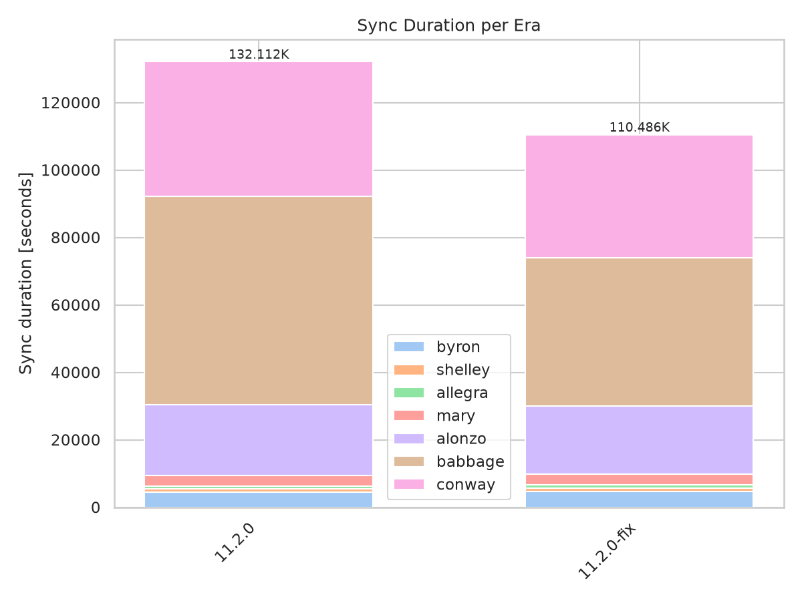
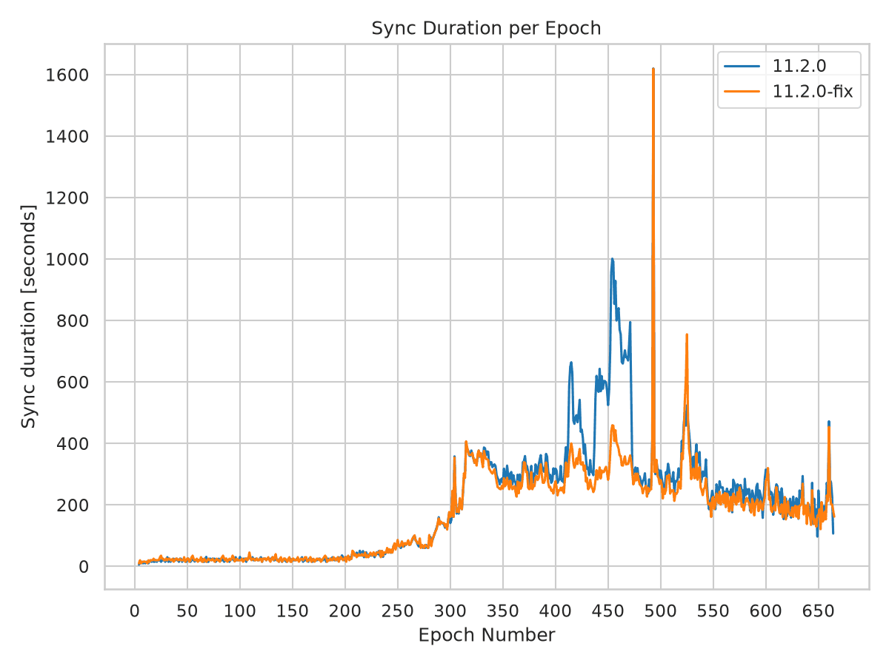
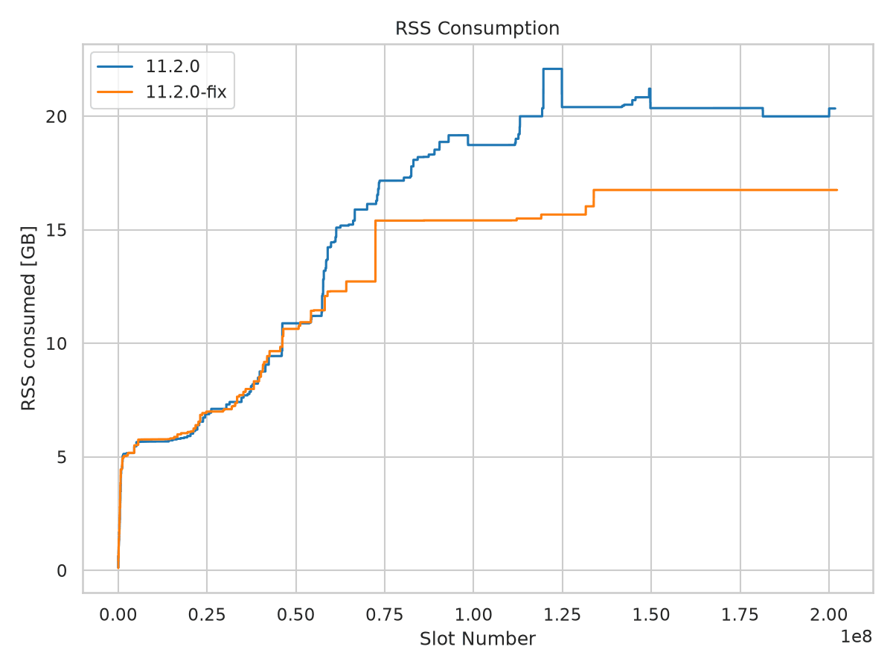
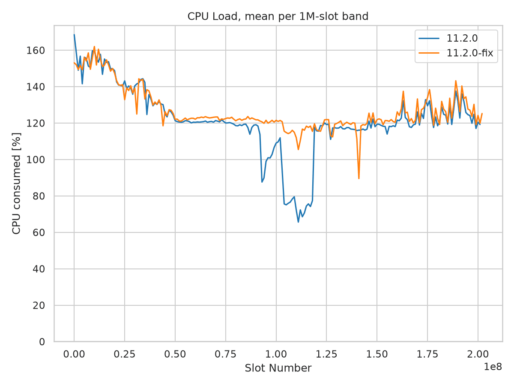

Mainnet Sync Report - 11.2.0 Fix
================================

Mainnet sync from genesis, comparing ``cardano-node`` 11.2.0 with an experimental
build containing memory-regression fixes at revision
``45aa403634fe2bb8817e65e7edf6b1d639a3bada``. This report labels that build
``11.2.0-fix``; the label is not a separate release version.

The :doc:`11.2.0 report <mainnet_11_2_0>` found higher retained memory and slower
syncing than 11.1.1, with configuration differences that limited attribution.
Here, both runs use matching effective startup settings, including Genesis mode
and the same snapshot policy. The comparison checks whether the experimental
build improves those measurements without changing those settings.

**Summary**

* **Memory drops substantially.** Peak RSS falls from 22.08 to 16.75 GiB
  (-24.1%), and peak garbage-collector live data falls from 18.03 to 10.93 GiB
  (-39.4%). The peak RSS reduction remains over matching slot ranges.
* **Most of the sync slowdown disappears.** Reported sync time falls from
  132,111 to 110,485 seconds (-16.4%). Babbage takes 28.6% less time over the
  same chain range and accounts for 81.6% of the saving.
* **Utilization improves without increasing total CPU work.** Mean CPU load
  rises from 112% to 123% of one core, while total CPU time falls 8.0%.
* **Snapshot behavior changes despite matching settings.** Completed snapshot
  writes increase from nine to 176, and major collections increase from 812 to
  1,321. Total allocation remains approximately 257 TB.
* **A residual historical gap remains.** Peak RSS is still 8.6% above the
  11.0.1 baseline. Early-chain memory use is essentially unchanged from 11.2.0.
  Those historical comparisons are not configuration-controlled.

Key Metrics
-----------

.. list-table:: Whole-run measurements
   :widths: 40 20 20 20
   :header-rows: 1

   * - Metric
     - 11.2.0
     - 11.2.0-fix
     - Change
   * - Reported sync time
     - 132,111 s
     - 110,485 s
     - -16.4%
   * - Peak RSS
     - 22.08 GiB
     - 16.75 GiB
     - -24.1%
   * - Mean RSS
     - 17.56 GiB
     - 14.32 GiB
     - -18.5%
   * - Peak GC live bytes
     - 18.03 GiB
     - 10.93 GiB
     - -39.4%
   * - Mean CPU load
     - 112%
     - 123%
     - +10.1%
   * - Total CPU time
     - 148,307 s
     - 136,418 s
     - -8.0%
   * - Last slot at sync completion
     - 201,746,270
     - 202,259,080
     - +512,810

CPU load is expressed as percent of a single core: 123% is approximately 1.23
cores busy on average. Memory values use GiB (2**30 bytes). Percent changes use
unrounded values.

Sync Performance
----------------

The experimental build finishes approximately six hours earlier while syncing
512,810 more slots (+0.25%). Babbage alone saves 17,638 seconds, or 4 h 54 min,
over the same fixed range of 61.344 million slots. This reverses most of the
Babbage slowdown observed in the preceding report.

.. list-table:: Sync duration per era, seconds
   :widths: 25 25 25 25
   :header-rows: 1

   * - Era
     - 11.2.0
     - 11.2.0-fix
     - Change
   * - Byron
     - 4,402
     - 4,661
     - +5.9%
   * - Shelley
     - 1,110
     - 1,090
     - -1.8%
   * - Allegra
     - 794
     - 829
     - +4.4%
   * - Mary
     - 3,159
     - 3,229
     - +2.2%
   * - Alonzo
     - 21,018
     - 20,250
     - -3.7%
   * - Babbage
     - 61,644
     - 44,006
     - -28.6%
   * - Conway
     - 39,985
     - 36,421
     - -8.9%
   * - **Total**
     - **132,111**
     - **110,485**
     - **-16.4%**

The total uses the recorded whole-sync duration. In each run, the individual
era durations sum to one second more than that total.

**Byron is not directly comparable.** The original result begins era timing
after CLI readiness, first observing epoch 4, and records 4,406,400 Byron slots.
The experimental result records the launch boundary and all 4,492,800 Byron
slots from epoch 0. Both nodes actually sync from genesis. The apparent Byron
slowdown therefore mixes different timing and counting boundaries.

This boundary change is small relative to the whole-run saving. Measuring from
the first logged chain extension at slot 0 to the recorded sync-completion time
gives approximately 132,171 seconds for 11.2.0 and 110,485 seconds for the
experimental build, still a 16.4% reduction. The equal-work Babbage comparison
independently confirms the speed improvement.

Conway covers slightly more chain in the experimental run: its recorded length
increases from 68.256 to 68.688 million slots. Recorded throughput rises from
1,707 to 1,885 slots/s (+10.4%).

   Sync duration per era. Babbage accounts for most of the six-hour saving.

   Most of the additional delays around Babbage epochs 400-470 disappear.
   Individual spikes remain, so the improvement is not uniform across epochs.

Memory Consumption
------------------

Peak RSS falls by 5.33 GiB and mean RSS by 3.24 GiB. The RSS curves track closely
through the early chain, then separate around slots 55-60 million. The
experimental build holds roughly 15.4 GiB through much of Babbage, then reaches
a stable 16.75 GiB late-chain plateau. It never exceeds 20 GiB.

.. list-table:: Heap shape and retained data
   :widths: 50 25 25
   :header-rows: 1

   * - Measure
     - 11.2.0
     - 11.2.0-fix
   * - Nonzero heap samples with a recorded tip
     - 130,567
     - 108,891
   * - Peak RTS heap
     - 21.98 GiB
     - 16.64 GiB
   * - Mean RTS heap
     - 17.45 GiB
     - 14.21 GiB
   * - p99 RTS heap
     - 21.98 GiB
     - 16.64 GiB
   * - Heap decreases
     - 4
     - 0
   * - Heap samples > 20 GiB
     - 31.9%
     - 0.0%
   * - Peak GC live bytes
     - 18.03 GiB
     - 10.93 GiB
   * - Mean GC live bytes
     - 8.34 GiB
     - 6.64 GiB
   * - Major GCs during the resource-log window
     - 812
     - 1,321
   * - Allocation during the resource-log window
     - 256.50 TB
     - 256.97 TB

Peak live data falls by 7.09 GiB (-39.4%), and mean live data falls 20.3%. This
shows that the improvement includes less retained live data, not just reduced
unused heap capacity. Allocation changes by only +0.2%, while the major-GC
count rises 62.7%.

The absence of heap decreases in the experimental run is not, by itself,
evidence of a leak. The allocated heap reaches a lower plateau even though
major collections continue. The run does not establish behavior over longer
periods after reaching the chain tip.

   RSS separates after the early chain and settles at a substantially lower
   plateau in the experimental build. RTS heap follows essentially the same
   shape, approximately 0.1 GiB below RSS.

Memory Over Matching Chain Ranges
---------------------------------

Restricting both runs to slots <= 188 million leaves peak RSS unchanged at
22.08 and 16.75 GiB. Restricting the experimental run to the original run's
completion slot also leaves its peak unchanged. The reduction is therefore not
an artifact of comparing different chain endpoints.

.. list-table:: Peak RSS by 10 million-slot band, GiB
   :widths: 40 30 30
   :header-rows: 1

   * - Slot band
     - 11.2.0
     - 11.2.0-fix
   * - 0-10 million
     - 5.67
     - 5.77
   * - 20-30 million
     - 7.11
     - 7.10
   * - 40-50 million
     - 10.88
     - 10.64
   * - 60-70 million
     - 15.89
     - 12.72
   * - 80-90 million
     - 18.53
     - 15.41
   * - 100-110 million
     - 18.73
     - 15.41
   * - 120-130 million
     - 22.08
     - 15.67
   * - 150-160 million
     - 20.36
     - 16.75
   * - 180-190 million
     - 20.36
     - 16.75
   * - 190-200 million
     - 19.99
     - 16.75

The early-chain overhead is not removed: before slot 10 million, peak RSS is
5.77 GiB against 5.67 GiB in 11.2.0. Against the historical 11.0.1 baseline,
whole-run peak RSS remains 8.6% higher (16.75 versus 15.43 GiB), and peak live
data remains approximately 6.4% higher (10.93 versus 10.28 GiB). The baseline used
different software and configuration, so these are historical reference points,
not evidence that the remaining difference has the same cause.

CPU Load
--------

Whole-run CPU utilization rises from 112% to 123% of one core while total CPU
time falls from 148,307 to 136,418 seconds. The build finishes faster without
spending more aggregate CPU time. The largest utilization recovery is in the
Babbage window that previously showed a deep trough.

.. list-table:: Mean CPU load, percent of one core
   :widths: 50 25 25
   :header-rows: 1

   * - Phase
     - 11.2.0
     - 11.2.0-fix
   * - Slots 0-50 million
     - 142
     - 141
   * - Slots 50 million onward
     - 108
     - 121
   * - Slots 90-140 million
     - 93
     - 118
   * - Whole sync
     - 112
     - 123
   * - Peak sample
     - 357
     - 422

The curves remain close through the early chain. Most of the prolonged
utilization loss around slots 100-120 million disappears in the experimental
build, although shorter dips remain. The combination of higher utilization and
shorter elapsed time is consistent with less waiting; these measurements alone
do not identify a single bottleneck.

   Mean CPU load per one million-slot band. The experimental build largely
   avoids the original run's deep Babbage trough.

Configuration and Snapshot Behavior
-----------------------------------

Unlike the preceding comparison with 11.1.1, the two runs have matching
effective startup settings. Genesis and checkpoint hashes, peer targets, and
Genesis feature settings also match in the startup records.

.. list-table:: Effective settings from the node startup logs
   :widths: 40 30 30
   :header-rows: 1

   * - Setting
     - 11.2.0
     - 11.2.0-fix
   * - Consensus mode
     - GenesisMode
     - GenesisMode
   * - Snapshot interval
     - 86,400 slots
     - 86,400 slots
   * - Snapshot offset
     - 0
     - 0
   * - Snapshot minimum delay
     - 300 s
     - 300 s
   * - Snapshot maximum delay
     - 21,600 s
     - 21,600 s
   * - Snapshot rate limit
     - 600 s
     - 600 s
   * - Retained disk snapshots
     - 2
     - 2
   * - LedgerDB backend
     - V2InMemory
     - V2InMemory
   * - Query batch size
     - 100,000
     - 100,000
   * - Block-fetch concurrency, bulk / deadline
     - 1 / 1
     - 1 / 1

The observed snapshot schedule nevertheless changes substantially. The logs
contain nine completed snapshot writes in 11.2.0 and 176 in the experimental
run. The original run's first snapshot completes more than five hours after
the first chain extension; the experimental run's first completes in less than
one minute, followed by writes approximately every 10 minutes.

The startup delay settings therefore should not be treated as a description of
identical runtime scheduling in the two implementations. The changed snapshot
behavior accompanies lower retained data and a higher major-GC count, but this
comparison does not isolate which individual implementation change produces
each improvement.

Matching effective settings remove the principal configuration confounder from
the preceding report. They do not control peer availability, storage conditions,
or every runtime detail. This is one run per build, not a repeated benchmark or
a demonstration that every part of the historical memory gap is resolved.

System Configuration
--------------------

.. list-table:: Recorded run environment
   :widths: 30 70
   :header-rows: 0

   * - Environment
     - mainnet, sync from genesis
   * - CPU / RAM
     - 32 cores / 134 GB in both runs
   * - Kernel
     - 6.18.34 in both runs
   * - Compiler reported by CLI
     - ghc-9.6 in both runs
   * - CLI version
     - 11.6.0.0 in both runs
   * - 11.2.0
     - October 28-30, 2026; node revision recorded as ``11.2.0``;
       CLI revision ``dac0d7ab2dfd``
   * - 11.2.0-fix
     - November 3-4, 2026; node revision ``45aa403634fe``;
       CLI revision ``45aa403634fe``
   * - Chain size
     - 239.67 -> 239.88 GB, decimal bytes

Methodology
-----------

RSS, RTS heap, and CPU statistics come from the result JSON files. Memory
statistics exclude zero-valued fields, which represent missing resource
samples, and require a recorded tip to match the graph script. This yields
130,567 and 108,891 usable memory samples, respectively.

Whole-run means and threshold fractions are sample-weighted, not normalized
to equal time spent at each slot. Different sync speeds can change those
statistics. The matching-slot checks compare peaks without that weighting issue.

CPU means retain genuine zero-load samples and use stored values without
rescaling. The smoothed figure averages samples into one million-slot bands,
keeping bands with at least 20 samples. Total CPU time is the change in the
node log's cumulative CPU-tick counter divided by 100.

GC live bytes, major collections, allocation, and completed snapshot writes
come from the full node logs. They contain 130,576 and 108,897 resource samples,
including samples without a recorded tip. Live-data means are arithmetic means
of those samples. Major-GC and allocation totals are the last counter minus
the first counter in each resource-log window, not process-lifetime maxima.
Allocation uses decimal TB.

Heap decreases count successive decreases among the nonzero, tip-associated
heap samples in timestamp order. Threshold fractions refer to heap, not RSS.
The timing-boundary cross-check uses the first logged chain extension at slot
0 and the recorded sync-completion timestamp. Per-epoch timings remain based
on observed epochs; the experimental JSON's epoch-duration series begins at
epoch 4 even though its era summary correctly counts Byron from epoch 0.

Source Data
-----------

.. list-table:: Analysis inputs
   :widths: 25 75
   :header-rows: 0

   * - Result files
     - ``cardano-node-11.2.0.json`` and ``cardano-node-11.2.0-fix.json``
   * - Node logs
     - Archived resource traces, snapshot events, and effective startup
       configurations for both runs
   * - Historical baseline
     - ``cardano-node-11.0.1.json`` and the
       :doc:`11.1.1 report <mainnet_11_1_1>`
   * - Preceding comparison
     - :doc:`11.2.0 report <mainnet_11_2_0>`
