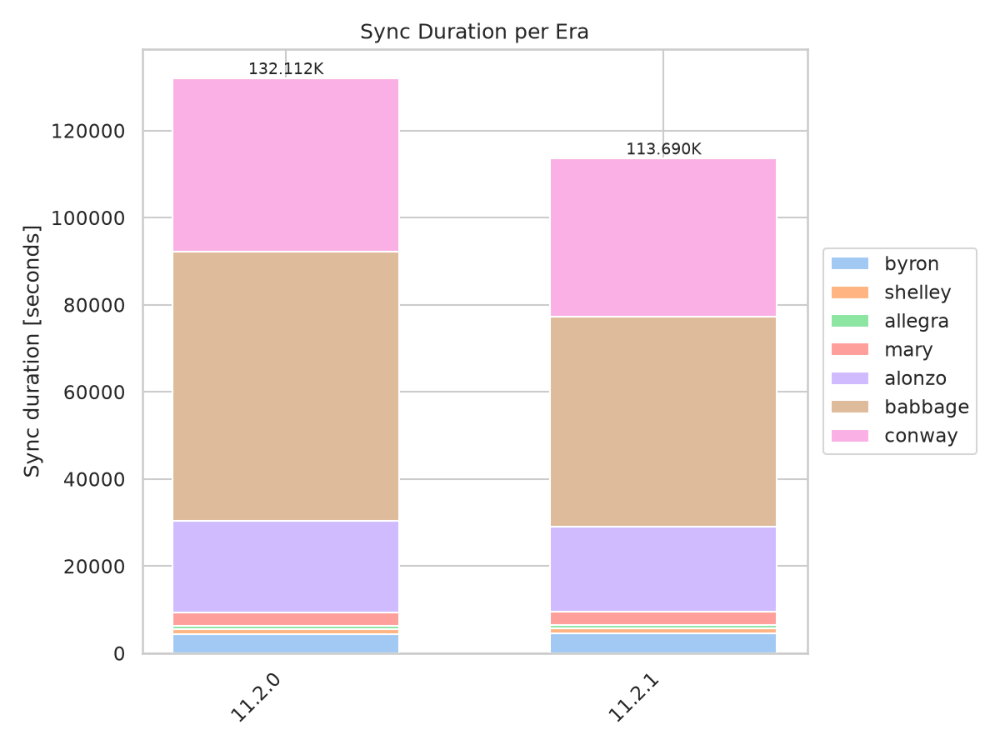
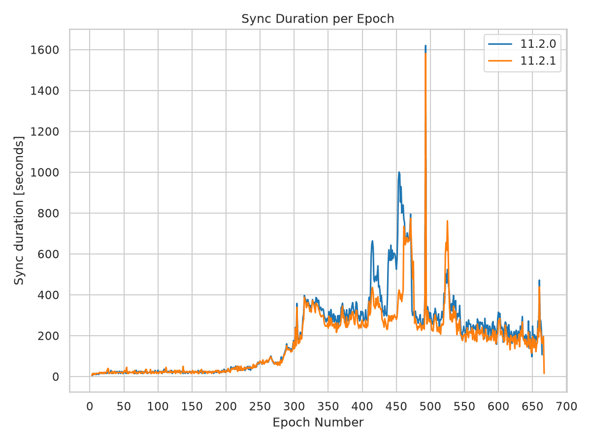
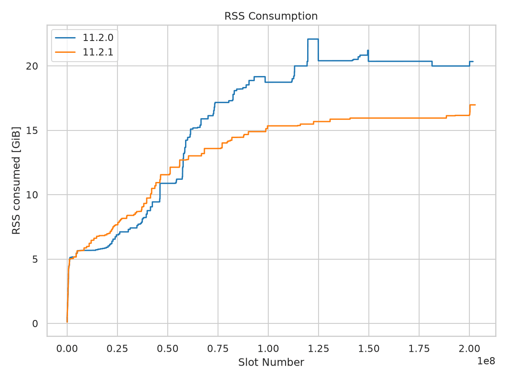
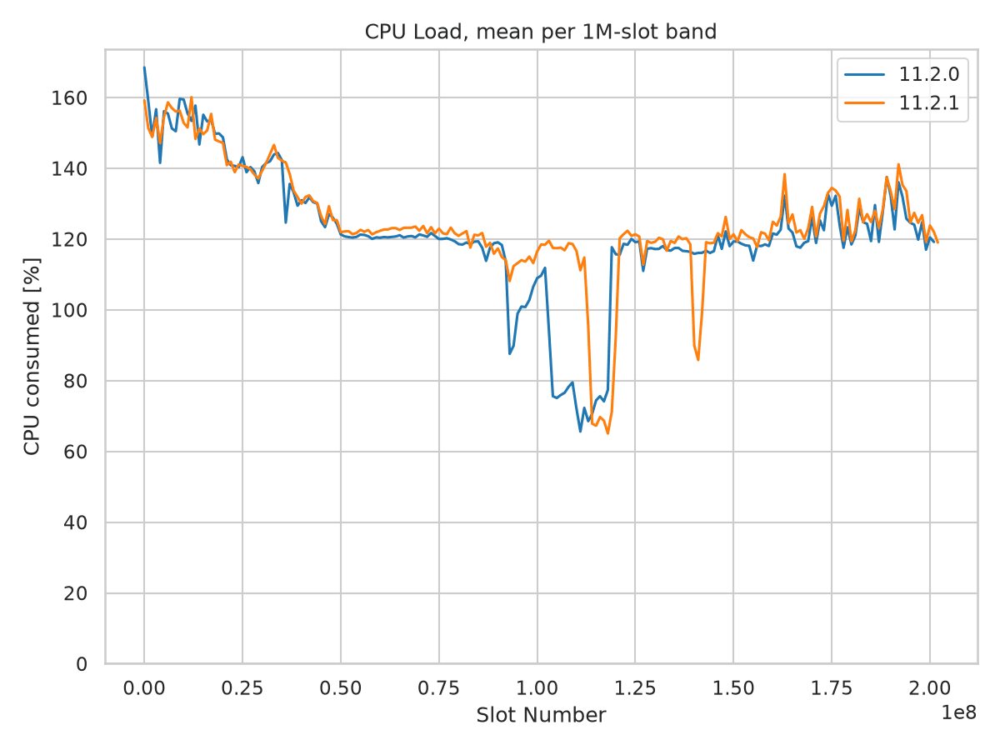

Mainnet Sync Report - 11.2.1
================================

Mainnet sync from genesis, comparing ``cardano-node`` 11.2.0 with the 11.2.1
release. The main purpose of 11.2.1 is to address the performance regressions
identified in the unreleased 11.2.0 build. This report evaluates the release's
sync time, memory consumption, and CPU utilization against that build.

An intermediate experimental run verified the fixes before their inclusion in
11.2.1; see the :doc:`fix-verification report <mainnet_11_2_0_fix>`. It provides
supporting evidence, not the primary baseline for this release report.

Most effective startup settings match between 11.2.0 and 11.2.1, but the
maximum snapshot delay changes from six hours to one hour. The kernel and CLI
versions also change, so this is not a fully controlled comparison.

**Summary**

* **Memory consumption drops substantially.** Peak RSS falls from 22.08 to
  16.98 GiB (-23.1%), and peak garbage-collector live data falls from 18.03 to
  11.00 GiB (-39.0%). The reduction remains over matching chain ranges.
* **Sync completes about five hours sooner.** Reported sync time falls from
  132,111 to 113,689 seconds (-13.9%), despite reaching 1,090,011 more slots.
  Babbage takes 21.6% less time over the same chain range and accounts for
  72.4% of the whole-run saving.
* **CPU utilization improves without more aggregate CPU work.** Mean CPU load
  rises from 112% to 118% of one core, while total CPU time falls 9.6%.
* **Snapshot scheduling changes substantially.** Completed writes increase
  from nine to 179, and major collections increase 59.5%. Total allocation
  falls 2.4%. The changed maximum snapshot delay limits causal attribution.
* **The improvements are not uniform.** Early-chain memory remains higher,
  and delays persist around Babbage epochs 461-475. Whole-run peak RSS is
  still 10.0% above the historical 11.0.1 baseline, which used different
  software and configuration.

Key Metrics
-----------

.. list-table:: Whole-run measurements
   :widths: 40 20 20 20
   :header-rows: 1

   * - Metric
     - 11.2.0
     - 11.2.1
     - Change
   * - Reported sync time
     - 132,111 s
     - 113,689 s
     - -13.9%
   * - Peak RSS
     - 22.08 GiB
     - 16.98 GiB
     - -23.1%
   * - Mean RSS
     - 17.56 GiB
     - 14.17 GiB
     - -19.3%
   * - Peak GC live bytes
     - 18.03 GiB
     - 11.00 GiB
     - -39.0%
   * - Mean CPU load
     - 112%
     - 118%
     - +5.2%
   * - Total CPU time
     - 148,307 s
     - 134,084 s
     - -9.6%
   * - Last slot at sync completion
     - 201,746,270
     - 202,836,281
     - +1,090,011

CPU load is expressed as percent of a single core: 118% is approximately 1.18
cores busy on average. Memory values use GiB (2**30 bytes). Percent changes use
unrounded values; CPU-load changes are relative percentages, not percentage
points.

Sync Performance
----------------

11.2.1 finishes 18,422 seconds (5 h 7 min) sooner than 11.2.0 while reaching
1,090,011 more slots (+0.54%). Babbage saves 13,334 seconds over the same
61.344 million-slot range, accounting for 72.4% of that whole-run saving.

Alonzo saves a further 1,535 seconds (-7.3%). Conway completes 3,645 seconds
sooner (-9.1%) while covering more chain. Improvements in these later eras
outweigh the smaller differences in early-era timings.

.. list-table:: Sync duration per era, seconds
   :widths: 25 25 25 25
   :header-rows: 1

   * - Era
     - 11.2.0
     - 11.2.1
     - Change
   * - Byron
     - 4,402
     - 4,548
     - +3.3%
   * - Shelley
     - 1,110
     - 1,101
     - -0.8%
   * - Allegra
     - 794
     - 824
     - +3.8%
   * - Mary
     - 3,159
     - 3,084
     - -2.4%
   * - Alonzo
     - 21,018
     - 19,483
     - -7.3%
   * - Babbage
     - 61,644
     - 48,310
     - -21.6%
   * - Conway
     - 39,985
     - 36,340
     - -9.1%
   * - **Total**
     - **132,111**
     - **113,689**
     - **-13.9%**

The total uses the recorded whole-sync duration. Individual era durations sum
to one second more than that total in each run. The stacked graph uses the era
sums, so its totals differ from the table's whole-run totals by one second.

**Byron timing boundaries differ from the original 11.2.0 result.** That result
first observes epoch 4 and counts 4,406,400 Byron slots. The 11.2.1 result
records the launch boundary and counts all 4,492,800 slots from epoch 0. Both
nodes actually sync from genesis. Measuring from the first logged chain
extension at slot 0 to recorded sync completion gives approximately 132,171
and 113,689 seconds, respectively, still a 14.0% reduction. The apparent
Byron slowdown mixes different timing and counting boundaries.

Conway's recorded length increases from 68.256 million slots in 11.2.0 to
69.552 million in 11.2.1. Recorded throughput rises from 1,707 to 1,913 slots/s
(+12.1%). These era lengths use the recorded epoch boundaries, not the exact
completion-slot differences.

   Babbage accounts for most of the five-hour saving, with further improvements
   in Alonzo and Conway.

The Babbage improvement is not uniform. Epochs 400-460 take 19,329 seconds
instead of 31,130 (-37.9%), but epochs 461-475 take 9,860 seconds instead of
9,270 (+6.4%). The broader slowdown is reduced, not every local delay.

   Much of the broad Babbage slowdown disappears, but delays remain around
   epochs 461-475. The large spike at epoch 493 also remains: 1,620 seconds
   in 11.2.0 and 1,581 seconds in 11.2.1.

Memory Consumption
------------------

Peak RSS falls by 5.11 GiB and mean RSS by 3.39 GiB. The release uses more
memory over some early-chain ranges, but the curves separate in its favor
around slots 55-60 million. RSS stays near 15.95 GiB over much of the late
chain, then rises to 16.98 GiB around slot 200.25 million. It never exceeds
20 GiB, unlike 11.2.0.

.. list-table:: Heap shape and retained data
   :widths: 50 25 25
   :header-rows: 1

   * - Measure
     - 11.2.0
     - 11.2.1
   * - Nonzero heap samples with a recorded tip
     - 130,567
     - 112,107
   * - Peak RTS heap
     - 21.98 GiB
     - 16.80 GiB
   * - Mean RTS heap
     - 17.45 GiB
     - 14.00 GiB
   * - p99 RTS heap
     - 21.98 GiB
     - 16.80 GiB
   * - Heap decreases
     - 4
     - 0
   * - Heap samples > 20 GiB
     - 31.9%
     - 0.0%
   * - Peak GC live bytes
     - 18.03 GiB
     - 11.00 GiB
   * - Mean GC live bytes
     - 8.34 GiB
     - 6.76 GiB
   * - Major GCs during the resource-log window
     - 812
     - 1,295
   * - Allocation during the resource-log window
     - 256.50 TB
     - 250.33 TB

Peak live data falls by 7.03 GiB (-39.0%), and mean live data falls 18.9%.
The improvement therefore includes less retained live data, not just reduced
unused heap capacity. Major collections increase 59.5%, while total
allocation falls 2.4%.

The absence of heap decreases does not itself establish a leak: the release
retains a substantially smaller heap while major collections continue. The
late increase means this run should not be presented as proof of a permanent
post-sync plateau or of behavior over longer periods at the chain tip.

   The release remains well below 11.2.0 after the early chain. RTS heap follows
   essentially the same shape, approximately 0.16 GiB below release RSS.

Memory Over Matching Chain Ranges
---------------------------------

Restricting both runs to slots <= 188 million gives peak RSS of 22.08 GiB for
11.2.0 and 15.95 GiB for 11.2.1 (-27.8%). Restricting 11.2.1 to 11.2.0's exact
completion slot includes its late increase, leaving its 16.98 GiB peak
unchanged. The memory reduction is therefore not an artifact of comparing
different chain endpoints.

.. list-table:: Peak RSS by 10 million-slot band, GiB
   :widths: 40 30 30
   :header-rows: 1

   * - Slot band
     - 11.2.0
     - 11.2.1
   * - 0-10 million
     - 5.67
     - 5.98
   * - 20-30 million
     - 7.11
     - 8.39
   * - 40-50 million
     - 10.88
     - 11.55
   * - 60-70 million
     - 15.89
     - 13.59
   * - 80-90 million
     - 18.53
     - 14.67
   * - 100-110 million
     - 18.73
     - 15.34
   * - 120-130 million
     - 22.08
     - 15.68
   * - 150-160 million
     - 20.36
     - 15.95
   * - 180-190 million
     - 20.36
     - 16.13
   * - 190-200 million
     - 19.99
     - 16.23

**Early-chain memory is not improved.** Before slot 10 million, peak RSS is
5.98 GiB versus 5.67 GiB in 11.2.0. In the 20-30 million-slot band, peak RSS
increases from 7.11 to 8.39 GiB. The whole-run memory improvement does not mean
every chain range uses less memory.

.. list-table:: Historical memory reference points
   :widths: 40 30 30
   :header-rows: 1

   * - Build
     - Peak RSS
     - Peak GC live bytes
   * - 11.0.1
     - 15.43 GiB
     - 10.28 GiB
   * - 11.1.1
     - 21.16 GiB
     - 15.94 GiB
   * - 11.2.1
     - 16.98 GiB
     - 11.00 GiB

Whole-run peak RSS is 10.0% above 11.0.1 and 19.8% below 11.1.1. Peak live data
is 7.0% above 11.0.1 and 31.0% below 11.1.1. The 11.0.1 RSS gap narrows to 3.4%
when restricting the release to slots <= 188 million. These are historical
reference points with different software, configuration, and chain endpoints,
not a controlled demonstration that the remaining differences share one cause.

CPU Load
--------

Mean CPU utilization rises from 112% to 118% of one core. Total CPU time falls
from 148,307 to 134,084 seconds (-9.6%), despite the release reaching more
chain. The node finishes faster without spending more aggregate CPU time.

.. list-table:: Mean CPU load, percent of one core
   :widths: 50 25 25
   :header-rows: 1

   * - Phase
     - 11.2.0
     - 11.2.1
   * - Slots 0-50 million
     - 142
     - 142
   * - Slots 50 million onward
     - 108
     - 114
   * - Slots 90-140 million
     - 93
     - 105
   * - Whole sync
     - 112
     - 118
   * - Peak sample
     - 357
     - 348

The early-chain curves remain close. Over slots 90-140 million, mean CPU load
rises from 93% to 105%. Much of the prolonged utilization loss in 11.2.0 is
reduced, although a deep trough remains around slots 114-120 million, aligning
with the delays around epochs 461-475. The narrower trough is consistent with
less waiting overall; these measurements alone do not identify a bottleneck.

   The release reduces the broad Babbage utilization trough, but a pronounced
   dip remains near slots 114-120 million.

Configuration and Snapshot Behavior
-----------------------------------

Genesis and checkpoint hashes, peer targets, Genesis feature settings, and
block-fetch concurrency match between the two startup records. The effective
maximum snapshot delay does not: it is 3,600 seconds in 11.2.1 versus 21,600
seconds in 11.2.0. The node's snapshot-policy startup message also confirms
the release's one-hour maximum.

.. list-table:: Effective settings from the node startup logs
   :widths: 40 30 30
   :header-rows: 1

   * - Setting
     - 11.2.0
     - 11.2.1
   * - Consensus mode
     - GenesisMode
     - GenesisMode
   * - Snapshot interval
     - 86,400 slots
     - 86,400 slots
   * - Snapshot offset
     - 0
     - 0
   * - Snapshot minimum delay
     - 300 s
     - 300 s
   * - Snapshot maximum delay
     - 21,600 s
     - 3,600 s
   * - Snapshot rate limit
     - 600 s
     - 600 s
   * - Retained disk snapshots
     - 2
     - 2
   * - LedgerDB backend
     - V2InMemory
     - V2InMemory
   * - Query batch size
     - 100,000
     - 100,000
   * - Block-fetch concurrency, bulk / deadline
     - 1 / 1
     - 1 / 1

.. list-table:: Observed completed snapshot writes
   :widths: 50 25 25
   :header-rows: 1

   * - Measure
     - 11.2.0
     - 11.2.1
   * - Completed writes
     - 9
     - 179
   * - First completion after first chain extension
     - 19,434 s
     - 63 s
   * - Median completion-to-completion interval
     - 14,747 s
     - 628 s

The first snapshot completes more than five hours after the first chain
extension in 11.2.0, but after about one minute in 11.2.1. Subsequent release
writes complete approximately every 10 minutes. This substantial scheduling
change accompanies lower retained data and more major collections, but the
comparison does not isolate the contribution of each implementation or
configuration change.

This is one run per build, not a repeated benchmark. Peer availability,
storage conditions, and other runtime effects are not controlled. The results
show substantial improvements in the release relative to 11.2.0, not proof
that every historical regression or local delay is resolved.

Supporting Evidence From Fix Verification
--------------------------------------------

Before the release, an experimental build at revision
``45aa403634fe2bb8817e65e7edf6b1d639a3bada`` verified the fixes using the same
effective startup settings as 11.2.0, including the six-hour maximum snapshot
delay. The :doc:`verification report <mainnet_11_2_0_fix>` calls that build
``11.2.0-fix``; it was a validation run, not a separate release baseline.

That run supports the release findings in two ways:

* Peak RSS was 16.75 GiB and peak live data was 10.93 GiB, close to the
  release's 16.98 and 11.00 GiB. The lower memory footprint was therefore
  already observed with the fixes before the release's snapshot-setting change.
* It recorded 176 completed snapshot writes, close to the release's 179,
  despite retaining 11.2.0's maximum-delay setting. The change from sparse to
  frequent writes cannot be explained solely by the release's shorter maximum.

The verification run completed in 110,485 seconds. The release takes 2.9%
longer while reaching 577,201 more slots. Its fixed-length Babbage era takes
9.8% longer, with a deeper utilization trough around epochs 461-475, partly
offset by faster syncing elsewhere. This variation limits claims of identical
timing across the two fixed builds, but does not change the release's 13.9%
improvement over 11.2.0. Repeated,
matched-setting runs would be needed to attribute that variation.

System Configuration
--------------------

.. list-table:: Recorded run environment
   :widths: 30 70
   :header-rows: 0

   * - Environment
     - mainnet, sync from genesis
   * - CPU / RAM
     - 32 cores / 134 GB in both runs
   * - Host recorded in node logs
     - ``ci11`` in both runs
   * - Kernel
     - 6.18.34 for 11.2.0; 6.18.59 for 11.2.1
   * - Compiler reported by CLI
     - ghc-9.6 in both runs
   * - CLI version
     - 11.6.0.0 for 11.2.0; 11.7.0.0 for 11.2.1
   * - 11.2.0
     - October 28-30, 2026; node revision recorded as ``11.2.0``;
       CLI revision ``dac0d7ab2dfd``
   * - 11.2.1
     - November 10-11, 2026; node revision recorded as ``11.2.1``;
       CLI revision ``90bc1cd9380a``
   * - Chain size
     - 239.67 -> 240.32 GB, decimal bytes

Methodology
-----------

RSS, RTS heap, and CPU statistics come from the result JSON files. Memory
statistics exclude zero-valued fields, which represent missing resource
samples, and require a recorded tip to match the graph script. This yields
130,567 and 112,107 usable memory samples for 11.2.0 and 11.2.1, respectively.

Whole-run means and threshold fractions are sample-weighted, not normalized
to equal time spent at each slot. Different sync speeds can change those
statistics. Matching-slot checks compare peaks without that weighting issue.
Slot bands include their lower bound and exclude their upper bound.

CPU means retain genuine zero-load samples and use stored values without
rescaling. The smoothed figure averages samples into one million-slot bands,
keeping bands with at least 20 samples. Total CPU time is the change in the
node log's cumulative CPU-tick counter divided by 100.

GC live bytes, major collections, allocation, and completed snapshot writes
come from the full node logs. They contain 130,576 and 112,114 resource samples,
including samples without a recorded tip. Live-data means are arithmetic means
of those samples. Major-GC and allocation totals are the last counter minus
the first counter in each resource-log window, not
process-lifetime maxima. Allocation uses decimal TB. Snapshot counts include
only completed 'Took ledger snapshot' events, not the preceding 'Taking'
events.

Heap decreases count successive decreases among nonzero, tip-associated heap
samples in timestamp order. Threshold fractions refer to heap, not RSS. The
timing-boundary cross-check uses the first logged chain extension at slot 0
and the recorded sync-completion timestamp. Per-epoch timings use observed
epochs: the series begin at epoch 4 for 11.2.0 and epoch 3 for 11.2.1, even
though the release's era summary counts Byron from epoch 0. The final observed
epoch is partial and should not be compared as a full epoch.

Graphs use ``sync_tests/scripts/sync_static_graphs.py`` with the two result
files in table order, explicit labels ``11.2.0`` and ``11.2.1``, node mode,
and 150 dpi PNG output. The era graph's legend is placed outside the bars to
keep its totals visible.

The supplementary verification measurements use the same calculation methods.
Its JSON contains 108,891 usable memory samples, and its full log contains
108,897 resource samples. The verification run took place on November 3-4, 2026.

Source Data
-----------

.. list-table:: Analysis inputs
   :widths: 25 75
   :header-rows: 0

   * - Result files
     - ``cardano-node-11.2.0.json`` and
       ``cardano-node-11.2.1.json``
   * - Node logs
     - ``11.2.0/node_sync.log`` and
       ``11.2.1/node_sync.log``
   * - Completion cross-check
     - ``11.2.1/sync_markers_mainnet.json``
   * - Historical baselines
     - ``cardano-node-11.0.1.json`` and ``cardano-node-11.1.1.json``,
       with their archived resource logs; see the
       :doc:`11.1.1 report <mainnet_11_1_1>`
   * - Regression baseline report
     - :doc:`11.2.0 report <mainnet_11_2_0>`
   * - Supplementary fix verification
     - :doc:`11.2.0 fix report <mainnet_11_2_0_fix>`,
       ``cardano-node-11.2.0-fix.json``, and
       ``11.2.0-fix/node_sync.log``
